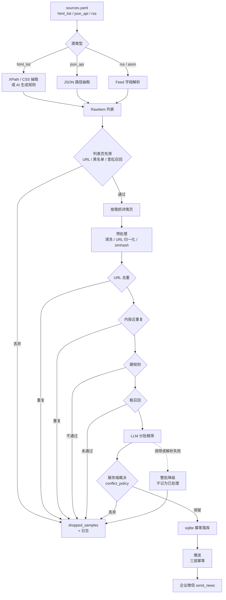

# 信息抓取推送系统 · 设计文档

```
多源采集 → 结构化 → 预处理 → 多级过滤 → LLM 按意图精筛 → 幂等推送
```

## 目录

- [1. 设计思路](#1-设计思路)
- [2. 快速开始](#2-快速开始)
- [3. 架构总览](#3-架构总览)
- [4. 采集](#4-采集)
- [5. 预处理](#5-预处理)
- [6. 筛选](#6-筛选)
- [7. 意图冲突](#7-意图冲突)
- [8. 推送与通知](#8-推送与通知)
- [9. 存储](#9-存储)
- [10. 成本与稳定性护栏](#10-成本与稳定性护栏)
- [11. 可观测性](#11-可观测性)
- [12. 配置参考](#12-配置参考)
- [13. 常见问题](#13-常见问题)
- [14. 术语表](#14-术语表)

---

## 1. 设计思路

### 1.1 五条原则

| 原则 | 落地方式 |
|---|---|
| **配置与代码分离** | 意图、Tag、阈值、源地址、截断长度、重试次数全部在 YAML |
| **确定性骨架 + LLM 判断** | 抓取、抽取、去重、召回都是确定性的；LLM 只做语义判断 |
| **失败不记账** | LLM 调用失败的内容不写入去重记录，下次运行还能重试 |
| **每层可降级** | AI 不可用有启发式，详情抓不到有摘要，通知失败只记日志 |
| **结论可追溯** | `filter_results` 存原始返回，`dropped_samples` 存丢弃原因 |

前三道（列表先筛、URL 去重、内容近重复）在抓详情页之前就把明显不该抓的挡掉；中间两道（硬规则、粗召回）用零成本手段把候选压到个位数；只有最后剩下的才进 LLM。

设计顺序遵循三个约束：

1. **成本递增**：便宜的手段先上；
2. **先召回后精度**：前几道只淘汰明显无关的，宁可放过不可误杀；
3. **每层可解释**：每次丢弃都写 `stage` + `reason`，进日志和 `dropped_samples`。

---

## 2. 快速开始

### 2.1 安装

```bash
python -m venv .venv
# Windows: .venv\Scripts\activate
python -m pip install -r requirements.txt
```

以下三个是可选的，不装会自动降级：

| 包 | 作用 | 未安装时 |
|---|---|---|
| `trafilatura` | 正文抽取首选 | 回退 lxml 自研清洗 |
| `jieba` | 中文分词 | 回退「ASCII 词 + 中文二元组」 |
| `selenium` | JS 站兜底渲染 | 关闭 Selenium 兜底 |

### 2.2 密钥

密钥有三个来源，优先级从高到低：

1. `config/app.yaml` 里直接写（`llm.api_key`、`push.wecom.sendkey`）；
2. 环境变量——名字由 `llm.api_key_env`（默认 `DEEPSEEK_API_KEY`）和 `push.wecom.sendkey_env`（默认 `WECOM_SENDKEY`）指定；
3. 都没有 → 明确报错并终止，**绝不伪造结果**。

推荐用环境变量，仓库里的 `app.yaml` 保持空串。

### 2.3 最小配置

一个源最少只需要 URL：

```yaml
sources:
  - name: "auto-news"
    enabled: true
    type: "html_list"
    url: "https://example.com/news"
    auto_selectors: true
    max_items: 10
```

解析规则由 AI 生成、校验、缓存。想冻结规则，把生成好的 `selectors` 粘回 YAML 即可。

### 2.4 命令与参数

两个入口完全等价：`python main.py` 和 `python run_pipeline.py`。

| 参数 | 作用 |
|---|---|
| `--check-config` | 只校验三份配置，不联网，退出 |
| `--dry-run` | 只跑到粗筛，不调用 LLM、不推送 |
| `--limit N` | 本次最多处理 N 条原始条目 |
| `--source NAME` | 只跑指定源，可重复 |
| `--no-push` | 精筛后不推送 |
| `--setup-source URL` | 只生成并缓存该 URL 的解析规则 |
| `--name NAME` | 配合 `--setup-source` 指定源名 |
| `--config` / `--intent` / `--sources` | 覆盖三份配置的路径 |
| `--verbose` | 日志同时打印到终端 |

### 2.5 第一次运行会发生什么

1. 加载并校验三份 YAML，任何一份写错就终止（`--check-config` 可以提前发现）；
2. 逐个源抓列表页；`auto_selectors: true` 且缓存里没有规则时，**第一次会调用 AI 生成规则**（这一步慢，且消耗 token）；
3. 列表先筛 → 只为幸存者抓详情页；
4. 预处理、双层去重、硬规则、粗召回；
5. 剩下的候选进 LLM 精筛；
6. 保留项落库并推送；
7. 打印运行汇总。

第一次跑建议用 `--dry-run --limit 5`，先确认抓取和召回是否合理，再放开 LLM 和推送。

---

## 3. 架构总览

### 3.1 流程图



### 3.2 阶段与模块

| 阶段 | 代码模块 | 输入 → 输出 | 失败策略 |
|---|---|---|---|
| 源配置加载 | `crawler/sources.py` | YAML → `SourceConfig` 列表 | 单源写错只跳过该源 |
| 列表抓取 | `crawler/http.py`、`crawler/extract.py`、`crawler/feed.py` | URL → `RawItem` 列表 | 重试、换 UA、Selenium 兜底 |
| 自动适配 | `crawler/adapt.py` | 只有 URL → 选择器 | AI → 启发式 → 三层兜底 |
| 列表先筛 | `pipeline/runner.py` | `RawItem` → 幸存者 | 只淘汰明显无关的 |
| 详情抓取 | `crawler/sources.py` | 幸存者 → 带正文的 `RawItem` | 失败则用摘要继续 |
| 预处理 | `pipeline/preprocess.py` | HTML/文本 → 清洗正文、`url_norm`、simhash | 过短/空标题后续丢弃 |
| 双层去重 | `pipeline/dedup.py` | `ArticleItem` → 是否重复 | 命中即丢弃并留痕 |
| 硬规则 + 粗召回 | `pipeline/prefilter.py` | `ArticleItem` → 候选 + 信号 | 未通过即丢弃 |
| LLM 精筛 | `pipeline/llm_filter.py` | 候选批次 → `FilterResult` | 整批降级、单条降级 |
| 落库 | `pipeline/storage.py` | 结论 → sqlite 五张表 | 幂等 upsert |
| 推送 | `pipeline/push.py` | 保留项 → 企业微信 | 三层幂等、失败下次重试 |
| 通知 | `pipeline/notify.py` | 重要事件 → `send_text` | 通知失败不影响主流程 |

### 3.3 四个数据结构

整条链路只围绕四个对象流转，其余都是辅助：

| 对象 | 产生位置 | 职责 |
|---|---|---|
| `RawItem` | 爬虫层 | 只负责「拿全」标题、摘要、封面、正文 HTML，不做任何判断 |
| `ArticleItem` | 预处理层 | 清洗后的统一条目，补 `url_norm`、`content_hash`，承载筛选结果 |
| `FilterResult` | 精筛层 | 单条内容的判定：是否命中意图、分数、Tag、理由 |
| `TagSignals` / `Decision` | 粗筛层 | 命中了哪些 Tag/关键词、相似度多少；某阶段保留还是丢弃 |

分开的意义在于：**爬虫不需要知道 Tag 是什么，LLM 不需要知道 HTML 长什么样**。

### 3.4 目录结构

```text
config/          app.yaml / filter_intent.yaml / sources.yaml / prompts/
crawler/         http、extract、feed、adapt、ai_items、css、health、selenium_fallback
pipeline/        preprocess、dedup、prefilter、llm_client、llm_filter、storage、push、notify、runner
models.py        数据结构
settings.py      YAML → 强类型配置（含默认值与校验）
main.py          入口
run_pipeline.py  等价入口
send_wcom_msg.py 企业微信封装
log_recording.py 按月日志
data/ logs/ .tmp/ 运行时产物（gitignore）
```

---

## 4. 采集

### 4.1 三种源类型

| 类型 | 适用场景 | 关键配置 | 详情页行为 |
|---|---|---|---|
| `html_list`（默认） | 普通 HTML 列表页 | `selectors`（XPath/CSS）或 `auto_selectors: true` | 有 `detail_content` 用它，否则自动清洗 |
| `json_api` | JSON 接口 | `json.items` + 字段路径 | 配了 `json.content` 直接用，否则抓详情 |
| `rss` | RSS 2.0 / Atom | 只需 `url` | 有 `content:encoded` / `atom:content` 直接用，否则抓详情 |

### 4.2 反爬

`crawler/http.py` 做了这些事：

- 每次请求轮换 User-Agent（`fake_useragent` 优先，回退内置池）；
- 浏览器化请求头（`Accept`、`Accept-Language`、`Referer`、`Upgrade-Insecure-Requests`）；
- 网络错误 / 403 / 429 / 5xx 指数退避 + 抖动重试；
- 同站点限速（`delay_seconds`）；
- 复用 Session 保持 Cookie；
- 可选代理与 TLS 校验开关；
- 页面级缓存（同一次运行内相同页面只真正请求一次）。

**Selenium 兜底**只在两种情况下触发：

1. 源配置显式 `use_selenium: true`；
2. 自动判断：响应可见文本长度 < `crawl.content_min_chars`（默认 200），疑似 JS 空壳。

> **实践坑**：「可见文本过短」这个启发式对所有 URL 生效，包括 RSS/JSON 请求。某些站点（例如带阿里云 WAF 的 feed）会对普通请求返回一个 JS 挑战页，可见文本为 0，于是每次运行都会尝试启动 Chrome。
>
> 纯 RSS 场景建议关闭 `crawl.selenium_fallback.enabled`，或者让 feed/JSON 请求跳过这个启发式。

### 4.3 解析规则生成与自愈

#### 生成流程

1. 抓列表页 HTML；
2. 计算「页面结构指纹」：只取标签与 class，忽略文案，取前 600 个元素做 simhash；
3. 缓存命中且指纹一致 → 直接用缓存规则，**不调用 AI**；
4. 否则扫描页面，产出：
   - 候选容器提示（如 `//li[.//a[@href]]` 匹配 42 个、其中 27 个含有效链接）；
   - 示例条目 HTML；
   - 重复区块所在的 DOM 子树（容器 + 上溯 3 层），而不是整页 12k 字符；
5. AI 返回 `selectors` JSON；
6. **形态校验**：`list_item` 必须是绝对 XPath（`//` 或 `.//`），字段选择器必须是 `./` 相对 XPath；AI 返回 CSS 时自动转 XPath；
7. **确定性校验**：用真实页面抽一遍，过滤掉导航、`javascript:void(0)`、空链接等噪音，只要有效条目 ≥ `min_items` 且占比 ≥ 50% 就通过；
8. 校验不过 → 把错误原因带回 Prompt 重试（`max_attempts`，默认 3）；
9. 通过后写缓存；需要时再单独生成详情页正文选择器，试抽正文长度达标才算过。

第 6、7 步是这套机制可靠的原因：**AI 的输出必须能在真实页面上抽到东西，否则不算数**。单靠 Prompt 约束不住模型编造 XPath。

#### 缓存与自愈

规则缓存在 `data/source_profiles.json`，按 `url_norm` 索引，包含选择器、页面指纹、生成时间、尝试次数、连续 0 条次数。

| 情况 | 行为 |
|---|---|
| 结构变化 | 指纹不一致 → 重新生成 |
| 规则失效 | 缓存规则连续 `self_heal_after`（默认 2）次「抽到 0 条」→ 自动删除，下次重新生成 |
| 人工干预 | 删掉缓存条目即触发重建；把 `selectors` 粘回 `sources.yaml` 即冻结规则，不再调 AI |

### 4.4 三层兜底

| 层级 | 触发条件 | 做法 | 配置 |
|---|---|---|---|
| 1 结构抽取 | 正常情况 | AI/启发式/缓存的 XPath 抽条目，按需抓详情 | `crawl.auto.*` |
| 2 AI 直接抽条目 | 选择器抽到 0 条 | 让 AI 读页面文本 + HTML，直接输出条目 JSON | `crawl.auto.item_fallback` |
| 3 整页兜底 | 第 2 层也失败 | 把整页当一个候选，跳过黑名单/粗召回直接交给 AI | `crawl.auto.page_fallback` |

第 2 层仍然是条目级，后续去重/筛选/推送完全一致；第 3 层是整页级，推送的是列表页 URL，日志会明确写「降级为整页候选」。

另外，列表页里与列表同目录的兄弟栏目链接会被自动过滤（`_is_nav_like`），避免把导航/分页当成文章。

### 4.5 源健康与熔断

某个源长期抽不到东西时，继续每轮都抓是纯浪费，还会加速被封。

- `crawl.source_failure_threshold`（默认 3）：连续失败 N 次后进入冷却；
- `crawl.source_cooldown_minutes`（默认 360）：冷却期内跳过该源；
- 状态落在 `data/source_health.json`，删掉文件即重置。

---

## 5. 预处理

### 5.1 正文清洗

`clean_content()` 的顺序：

1. 优先用 `trafilatura`（可选依赖）；
2. 抽取结果太短（< 50 字）→ 回退 lxml 清洗；
3. 清洗：
   - 删除 `script/style/noscript/iframe/svg` 等非正文标签；
   - 删除 `nav/header/footer/aside` 等语义容器；
   - 按 class/id 命中 `nav`、`footer`、`sidebar`、`advert`、`comment`、`related` 等样板词；
   - 删除「分享到」「责任编辑」「版权声明」等样板行；
   - 按块级元素保留段落边界，去重重复行；
4. 最后按 `max_content_chars`（默认 20000）截断。

### 5.2 URL 归一化

它同时用于列表阶段的运行内去重、URL 库去重、落库主键和推送幂等。归一化规则：

- host 小写，去掉 `:80` / `:443`；
- 去掉锚点；
- 去掉跟踪参数（配置里的 `strip_query_params` 加上所有 `utm_*`）；
- query 参数按 key/value 排序；
- 去掉末尾斜杠。

这样 `?utm_source=x`、`#comment`、`HTTP://Example.com/a/` 这些变体都会收敛到同一个主键，避免「同一条内容因为 URL 写法不同被推多次」。

### 5.3 simhash 指纹

用于内容近重复检测。正文为空时为空串，表示「不参与内容比对」；正文很短但非空时仍然会算指纹——这也是短文本更容易被判成近重复的原因。

- 分词：ASCII 词 + 中文二元组（不依赖第三方库，保证向量可比）；
- 每个 token 用 blake2b 取 64 位哈希；
- 按 TF 亚线性加权，对 64 个 bit 投票；
- 得到 64 位 simhash，汉明距离越小越相似。

### 5.4 分词与关键词

- 粗召回的关键词优先用 `jieba`（可选）；
- 没装 `jieba` 时回退「ASCII 词 + 中文二元组」；
- 抽关键词时会自动把「不要：融资新闻」这类负面段落排除在正向召回之外，避免「融资」反而成为召回词。

---

## 6. 筛选

这是整条流水线的核心。

| # | 闸门 | 判据 | 主要参数 | 丢弃 stage |
|---|---|---|---|---|
| 1 | 列表页先筛 | URL 去重 + 标题/摘要黑名单 + 宽松粗召回 | `crawl.list_prefilter` | `list_prefilter*` |
| 2 | URL 去重 | `url_norm` 近 N 天是否见过 | `dedup.url_window_days` | `dedup_url` |
| 3 | 内容近重复 | simhash 汉明距离 | `dedup.content_window_days`、`hamming_threshold` | `dedup_content` |
| 4 | 硬规则 | 黑名单、正文过短、空标题 | `preprocess.*` | `hard_rule` |
| 5 | 粗召回 | Tag / 意图关键词 / 向量相似度，三者取或 | `prefilter.*` | `prefilter_recall`、`prefilter_exclude` |
| 6 | LLM 精筛 | 自然语言意图 + 冲突策略 + 分数阈值 | `llm.*`、`score_threshold` | `llm` |

### 6.1 漏斗示例

把这条链路想成一个漏斗（数字仅为示意，实际取决于源和意图）：

| 阶段 | 剩余条数 | 说明 |
|---|---:|---|
| 列表条目 | 120 | 3 个源抓到的全部条目 |
| 列表先筛后 | 45 | 只为这 45 条抓详情页 |
| URL 去重后 | 40 | 近 30 天已处理过的被挡掉 |
| 内容去重后 | 37 | 转载、换 URL 再发被挡掉 |
| 硬规则后 | 35 | 黑名单、过短、空标题被挡掉 |
| 粗召回后 | 14 | 进入 LLM 的候选 |
| LLM 保留 | 5 | 真正符合意图的 |
| 推送 | 5 | 按上限、按幂等推送 |

### 6.2 第一道：列表页先筛

在抓详情页之前执行，目的是「不值得抓的条目不要浪费请求」。它做四件事：

1. **运行内 URL 去重**：同一次运行里归一化后相同的 URL 只留一条；
2. **URL 库去重**：近 N 天已处理过的直接跳过；
3. **标题/摘要硬规则**：标题 < 3 字、命中黑名单关键词 → 丢弃；
4. **宽松粗召回**：用标题 + 摘要算 Tag/关键词/向量相似度，但**相似度阈值打 7 折**（0.35 → 0.245），任一信号命中即通过。

`exclude` Tag 在这一层是硬否：标题/摘要命中即丢弃。

为什么阈值要打 7 折？列表阶段只有标题和摘要，信息量少，严格阈值会误杀；真正的严格判断留给拿到正文之后的粗召回和 LLM。

> 这一层对 RSS 同样生效。如果 feed 只有 `content:encoded`、没有 `description`，列表阶段只能看到标题，可能误杀。这种源可以设 `crawl.list_prefilter: false`。

### 6.3 第二道：URL 去重

- 窗口：`dedup.url_window_days`，默认 30 天；
- 主键：`url_norm`；
- 命中后不删除旧记录，而是更新 `last_seen`、`hit_count`，便于观察某个 URL 被反复抓到的频率。

**只有产出结论的内容才会写入去重记录。** 被 URL 去重、内容去重、硬规则、粗召回丢弃的条目不会被标记为「已处理」，下次运行还会重新评估。

这是刻意的：

- 好处：调整意图/阈值后，之前被粗筛误杀的条目有机会回来；
- 代价：这些条目每轮都会重新抓取、重新粗筛（但不花 LLM 钱）。

LLM 判定为「不相关」的条目会被记录，30 天内不再重复评估。想重新评估，删掉 `seen_urls` 和 `content_fingerprints` 里对应的行即可。

### 6.4 第三道：内容近重复

- 窗口：`dedup.content_window_days`，默认 7 天；
- 阈值：`dedup.hamming_threshold`，默认 3；
- 单次最多扫描 `fingerprint_max_scan`（默认 5000）条历史指纹；
- 同一条内容自己的指纹不参与比对。

适用场景：同一篇文章被不同源转载、同一站点换了 URL 再发、聚合站与原文重复。

局限也很明显：**文本越短，simhash 越不稳**。RSS 只有几十字摘要时，不同文章可能因为词太少而被判成近重复。此时可以：

- 把 `hamming_threshold` 降到 1；
- 或把 `content_window_days` 设为 0，彻底关闭内容判重，只靠 URL 去重。

### 6.5 第四道：硬规则

三条规则，全部是本地字符串/长度判断：

1. 清洗后正文长度 < `preprocess.min_content_chars`（默认 80）→ 丢弃；
2. 标题为空且 `drop_short_title: true` → 丢弃；
3. 标题 + 摘要 + 正文前 2000 字命中 `preprocess.blacklist_keywords` → 丢弃。

放在 LLM 之前，是为了用几乎为零的成本挡掉「招聘」「抽奖」「优惠券」这类明显无关内容。

> 只吃 RSS 摘要时，最常见的误杀就是第 1 条：很多 feed 的 `description` 只有三五十字。把 `min_content_chars` 调到 0~30，或者确保 feed 带 `content:encoded`。

### 6.6 第五道：粗召回

粗召回的目标不是「判得准」，而是「别把可能相关的内容漏掉」，所以三个信号是**或**关系：

```python
if (has_must and must_ok) or kw_ok or sim_ok:
    # 进入 LLM 精筛
```

三个信号分别是：

1. **Tag 命中**：配置了 `tags.must_include` 时，命中数 ≥ `must_include_min_hits`；
2. **意图关键词**：从 `intent.description` 的正面描述里抽出的关键词，命中数 ≥ `min_keyword_hits`（正例只参与意图向量，不参与关键词抽取）；
3. **向量相似度**：意图文本向量与候选文本向量的余弦相似度 ≥ `similarity_threshold`（默认 0.35）。

`tags.exclude` 是硬否：命中即丢弃，不进入 LLM。

#### `must_include` 不是「必须包含」

这个名字很容易误解。在 `conflict_policy: natural_language`（默认）下：

- `must_include` 只参与粗召回和解释；
- 即使一条内容没有命中任何 `must_include`，只要关键词或向量相似度过关，仍然会进入 LLM；
- 最终是否保留由自然语言意图决定，不由 Tag 决定。

真正想让 Tag 起决定作用，要把 `conflict_policy` 改成 `tags`。

#### 本地 embedding 是怎么算的

没有引入外部 embedding 服务，而是实现了一个确定性的 hashing-TF 向量：

1. 分词；
2. 对每个 token 做 blake2b 哈希，映射到 512 维桶；
3. 按 `1 + log(tf)` 加权；
4. L2 归一化；
5. 余弦相似度退化为内积。

它是词法级的，不理解同义词和语义。这不是缺陷，而是分工：

- 粗召回只需要判断「主题是否沾边」，词法相似度足够把人挡在 LLM 之外；
- 真正的语义判断交给 LLM。

如果将来要换成服务化 embedding，只需要替换 `HashingTfEmbedder` 的实现，接口不变。

### 6.7 第六道：LLM 精筛

筛选链路里唯一调用 LLM、也是唯一做语义判断的一层。

#### Prompt 的结构

模板固定为六段，顺序有讲究：

1. **角色**：严格、克制的内容筛选器；
2. **筛选意图**：自然语言描述 + 正例 + 反例 + 软性偏好；
3. **参考标签**：`must_include` / `boost` / `exclude`，明确说「只是辅助信号」；
4. **冲突规则**：三种策略的措辞从 `conflict_policy.yaml` 注入；
5. **输出约束**：只输出 JSON、字段名/类型/层级固定；
6. **候选内容**：每条包含 url、title、description、content。

固定指令块放在最前面，候选放在最后，是为了让同一轮里多个批次的固定前缀完全一致，利于模型侧的前缀缓存，降低 token 成本。

候选正文不是整篇塞进去，而是按「意图关键词 + Tag」择段：

- 保留开头约 30% 的导语；
- 按段落关键词命中密度补足；
- 默认封顶 `llm.content_max_chars`（1300 字）。

#### 模型输出

```json
{
  "items": [
    {
      "url": "候选里的原始 url",
      "title": "标题",
      "description": "一句话理解",
      "intent_matched": true,
      "matched_intent": "命中的子意图或 overall",
      "tags": ["只允许配置过的 Tag"],
      "score": 0.87,
      "is_relevant": true,
      "reason": "可追溯的判定理由"
    }
  ]
}
```

#### 服务端不直接采信模型结论

这是 LLM 工程化里很重要的一点：模型返回的 `is_relevant` 字段不会被直接使用（代码里甚至不读取它）。服务端会：

1. 严格 JSON 解析，不剥离代码块、不修补截断；
2. 校验 `url` 必须在本批输入里（防止串号）；
3. 校验 `intent_matched` 是布尔值；
4. `score` 转成数字并裁剪到 `[0, 1]`；
5. `tags` 只保留配置里出现过的词，模型自造的 Tag 一律忽略；
6. `matched_intent` 只在 `intent_matched=true` 时保留；
7. 按 `conflict_policy` 重新计算 `is_relevant`；
8. 在 `reason` 后追加分数、阈值、冲突与裁决说明。

换句话说，**模型负责「表达判断」，代码负责「执行规则」**。这样换模型、改 Prompt 时，业务不变量不会跟着漂移。

#### 失败与降级

| 场景 | 行为 |
|---|---|
| 网络错误 / 408、409、425、429 / 5xx | 重试 `max_retries` 次；仍失败 → 本批整批降级丢弃，**不写去重记录**，下次重试，发通知 |
| 返回非严格 JSON | 记原始返回摘要，整批降级丢弃，发 `parse_failure` 通知 |
| 漏返某条候选 | 该条单独丢弃并写丢弃样本，其余正常处理 |
| 字段类型非法 | 能夹逼的夹逼（score 裁剪），不能的丢该条 |
| 返回了本批之外的 url | 该条丢弃（疑似串号） |
| token 预算耗尽 | 停止调用 AI，剩余批次不记为已处理，下次继续 |
| API Key 缺失 | 明确报错并终止，绝不伪造结果 |

「失败不记账」是这条流水线最重要的可靠性设计之一：LLM 临时故障不会导致内容被永久跳过。

### 6.8 兼容模式：legacy Tag

如果 `intent.description` 为空、只配置了 Tag，并且 `allow_tag_only_legacy: true`，流水线进入 legacy 模式：

- 不调用 LLM；
- `must_include` / `boost` 命中即保留；
- `exclude` 命中即丢弃；
- 分数按命中数量拼一个可解释的值。

这保留了旧版「纯 Tag 过滤」的行为，便于迁移；但不是推荐用法，因为没有语义判断，Tag 写不全就会漏。

---

## 7. 意图冲突

模型会同时看到自然语言意图和 Tag。两者不一致时，由 `conflict_policy` 决定。冲突的情况：

- 命中了 Tag，但按意图判定不相关；
- 命中了 `exclude` Tag，但按意图判定相关。

| 策略 | `is_relevant` 的计算 | 适用场景 |
|---|---|---|
| `natural_language`（默认） | `intent_matched && score >= score_threshold` | 意图写得清楚，Tag 只做召回 |
| `tags` | 命中 must/boost 且未命中 exclude | Tag 维护得很准，想用 Tag 兜底 |
| `drop_on_conflict` | 有冲突直接 false，否则按意图判定 | 宁缺毋滥，冲突内容一律不要 |

- `tags` 策略下如果根本没配任何 Tag，会自动退化为按意图判定，并打日志；
- 出现冲突时，`reason` 一定追加 `｜冲突：…｜按 conflict_policy=… 裁决：保留/丢弃`，可追溯；
- 冲突次数会进 `PipelineStats.conflicts`，在运行汇总里能看到。

```text
筛选[保留] https://example.com/a1 | score=0.88 | tags=['Agent'] |
复盘了 LangGraph 多智能体编排的生产实践，含源码，符合意图；未命中 exclude。
（意图符合=True, score=0.88, 阈值=0.60）
```

---

## 8. 推送与通知

### 8.1 三层幂等

| 层 | 作用 | 失效场景 |
|---|---|---|
| 进程内集合 `_pushed_in_process` | 同一次运行内不重复推 | 进程重启后失效 |
| `push_log` 表 | 跨运行、跨重启挡住已推 URL | 手动删表会重推 |
| 推送接口返回码 | 只有 2xx 才写 `push_log` | 失败不写，下次可重试 |

关键点：**推送失败不写 `push_log`**。所以下游接口临时故障时，内容下一轮还会重试，而不是永久丢失。

### 8.2 只推保留项

`Pusher.push()` 只处理 `is_relevant=true` 的条目，并且受这些限制：

- `push.enabled`：总开关；
- `push.dry_run`：只记录不发送；
- `push.max_per_run`：单次运行最多推几条；
- `--no-push`：本次运行完全不推。

### 8.3 推送文案

`send_news(title, description, url, picurl)` 的签名保持不变，新增信息只拼进 `description`：

```text
匹配意图：多智能体协作落地（含代码示例）
命中标签：Agent、multi-agent
筛选理由：复盘了 LangGraph 多智能体编排的生产实践，含源码，符合意图；未命中 exclude。
（意图符合=True, score=0.88, 阈值=0.60）
摘要：我们团队用 LangGraph 把 12 个 Agent 编排上线……
来源：auto-news · 2026-11-04
链接：https://example.com/article-1
封面：https://example.com/img/agent.jpg
```

- 标题超过 64 字会截断；
- 摘要超过 120 字会截断；
- `picurl` 只接受 `http(s)`，相对路径和 `data:` 会被清空；
- 整段 description 受 `push.description_max_chars`（默认 500）限制。

### 8.4 报错通知

`notify.py` 用同一个渠道的 `send_text` 发文字通知，约束是：

- 只发配置白名单里的事件（`run_aborted`、`config_error`、`crawl_failure`、`source_adapt_failure`、`llm_failure`、`parse_failure`、`push_failure`、`summary`）；
- 同事件同内容在 `min_interval_seconds`（默认 300 秒）内只发一次；
- 单次运行最多 `max_per_run`（默认 5）条；
- dry-run 时默认静默；
- 通知失败只记日志，绝不影响主流程，也不会递归通知。

---

## 9. 存储

`data/state.db` 是 sqlite，标准库实现，开启 WAL。

| 表 | 作用 | 关键字段 |
|---|---|---|
| `seen_urls` | URL 去重 | `url_norm` 主键、`first_seen`、`last_seen`、`hit_count` |
| `content_fingerprints` | 内容指纹 | `url_norm`、`simhash`、`created_at` |
| `filter_results` | 精筛结果 | `url_norm` 主键、`score`、`is_relevant`、`reason`、`raw_response` |
| `dropped_samples` | 丢弃样本 | `stage`、`reason`、`title`，默认保留 7 天 |
| `push_log` | 推送幂等 | `url_norm` 主键、`channel`、`pushed_at`、`status` |

- `filter_results` 按 `url_norm` 幂等 upsert，同一 URL 重复判定只更新不新增；
- `raw_response` 保留模型单条返回（截断 4000 字），便于排查「模型当时为什么这么判」；
- `dropped_samples` 只短期保留，避免库无限膨胀；
- `push_log` 以 URL 为主键，意味着一篇内容在默认配置下终身只推一次。要重推，删掉对应行。

---

## 10. 成本与稳定性护栏

| 机制 | 行为 | 参数 |
|---|---|---|
| 列表页先筛 | URL 去重 + 黑名单 + 宽松召回，只为幸存者抓详情 | `crawl.list_prefilter` |
| 运行内页面缓存 | 同一次运行相同页面只请求一次 | `crawl.page_cache` |
| 精筛正文择段 | 按关键词挑段落，默认 1300 字封顶 | `llm.content_max_chars` |
| 固定指令块前置 | Prompt 固定前缀一致，利于模型侧前缀缓存 | 模板顺序 |
| 规则生成送子树 | 只送重复区块 DOM 子树 + 候选提示 + 示例条目 | `crawl.auto.html_max_chars` |
| 规则自愈 | 缓存规则连续 N 次抽到 0 条自动删除并重建 | `crawl.auto.self_heal_after` |
| token 预算 | 单次运行 prompt+completion 超预算即停止调用，剩余候选不记为已处理 | `llm.max_tokens_per_run` |
| 单源熔断 | 某源连续失败 N 次后冷却一段时间不再抓 | `crawl.source_failure_threshold` / `source_cooldown_minutes` |
| LLM 重试 | 只对网络错误 / 408、409、425、429 / 5xx 重试，其余 4xx 直接失败 | `llm.max_retries` |
| 推送上限 | 单次运行最多推 N 条 | `push.max_per_run` |

---

## 11. 可观测性

### 11.1 日志

所有日志走原有的 `log_recording.Logger()`，按月写到 `logs/YYYY-MM.log`；`--verbose` 时同时打印到终端。

典型日志：

```text
筛选模式：intent+tags（conflict_policy=natural_language, threshold=0.6）
源 auto-news 解析规则就绪（mode=ai）：list_item=//*[@id="wp--skip-link--target"]/div/ul/li
源 auto-news 详情页正文规则已生成：//article（试抽 1180 字）
列表页粗筛：40 -> 18 条进入详情抓取
粗筛通过 https://example.com/a1 | must_include=['Agent'] boost=['multi-agent'] exclude=- intent_kw=[...] sim=0.412
筛选[保留] https://example.com/a1 | score=0.88 | tags=['Agent'] |
丢弃[dedup_content] 某标题 | 正文与近 7 天内记录近重复（汉明距离 0 <= 阈值 3，命中的是 https://...）
丢弃[prefilter_exclude] 某融资新闻 | 命中 exclude Tag ['融资']
[pipeline] 阶段[llm] 共 3 条，保留 2，丢弃 1 | 丢弃原因：粗召回未通过…… ×1
[pipeline] LLM 调用 2 次（失败 0，解析失败 0），平均耗时 3.21s，tokens prompt=5210 completion=812
[pipeline] Tag 命中分布：Agent×3，multi-agent×1
[pipeline] 汇总 模式=llm 用时=8.4s LLM 调用=2 解析失败=0 冲突=0 推送 ok=2 失败=0 跳过=0
```

### 11.2 阶段统计

`PipelineStats` 按阶段记录 `total / kept / dropped / reasons`，常见阶段名：

`crawl`、`preprocess`、`dedup_url`、`dedup_content`、`hard_rule`、`prefilter`、`prefilter_exclude`、`prefilter_recall`、`llm`、`llm_error`、`llm_budget`、`push`。

调参时先看哪个阶段的 `dropped` 最多，再决定调哪个参数。

### 11.3 丢弃样本

`dropped_samples` 记录每条被丢弃内容的阶段和原因，是调意图/阈值最直接的依据。

```sql
-- 最近 20 条丢弃
SELECT stage, reason, title, created_at
FROM dropped_samples
ORDER BY id DESC LIMIT 20;

-- 按阶段统计丢弃量
SELECT stage, COUNT(*) AS n
FROM dropped_samples
GROUP BY stage
ORDER BY n DESC;
```

### 11.4 排障路径

看到「推送数量不对」时，按下面顺序查，基本能定位到具体哪一道：

| 现象 | 先看 | 再看 |
|---|---|---|
| 一条都没抓到 | 日志里有无「源 … 解析规则就绪」 | `--setup-source <URL>` 单独生成规则 |
| 抓到了但全部被丢 | `dropped_samples` 里 stage 分布 | 若是 `hard_rule` 占多数，先查 `min_content_chars` |
| 该留的被丢了 | 该条的 `reason` 和 `score` | 对比 `score_threshold` 与 `similarity_threshold` |
| 不该留的留下了 | `filter_results.raw_response` | 意图描述是否写得过宽，或 `conflict_policy` |
| 内容重复推送 | `push_log` 是否有该 `url_norm` | `url_norm` 归一化是否覆盖了新的参数写法 |
| LLM 一直失败 | 通知里的 `llm_failure` / `parse_failure` | `json_response_format`、模型名、余额 |

---

## 12. 配置参考

### 12.1 三个文件

| 文件 | 职责 | 换主题 | 换站点 |
|---|---|---|---|
| `config/filter_intent.yaml` | 筛选意图、Tag、冲突策略、阈值、粗召回 | ✅ 只改这里 | — |
| `config/app.yaml` | LLM、爬虫、去重、存储、推送、通知 | 偶尔调阈值 | 偶尔调超时/代理 |
| `config/sources.yaml` | 源地址与解析规则 | — | ✅ 只改这里 |

相对路径（`prompt_template`、`sources_path`、`storage.db_path`）按**项目根目录**解析，不受当前工作目录影响。

### 12.2 `filter_intent.yaml`

```yaml
intent:
  description: |
    我关注与「AI Agent 工程化落地」相关的内容，特别关注：
    - 多智能体协作、工具调用、提示词工程、评测与可观测性；
    - 有实操细节、代码示例或生产环境经验的分享。
    不要：融资新闻、产品发布会通稿、标题党、纯概念科普、课程种草、招聘信息。
  examples:
    include:
      - "某团队用 Agent 做客服自动化的落地复盘"
    exclude:
      - "某某公司完成 X 亿融资"
  preferences: |
    优先：有第一手数据、有失败经验、结论可复用的长文。

tags:
  must_include: ["Agent", "LLM"]
  boost: ["multi-agent", "tool use", "RAG", "eval"]
  exclude: ["招聘", "融资", "广告", "抽奖"]

conflict_policy: natural_language
score_threshold: 0.6

prefilter:
  embedding_model: "local-hashing"
  similarity_threshold: 0.35
  keyword_from_intent: true
  keyword_top_k: 40
  min_keyword_hits: 1
  must_include_min_hits: 1
```

- 用「关注… / 不要…」的结构，负面内容会被关键词抽取自动排除；
- 正例/反例不用多，各 2~3 条即可，重点覆盖边界情况；
- `preferences` 用来表达「长文优先」「不要营销稿」这类软要求；
- 只有标题+摘要的源（如 RSS），把 `similarity_threshold` 适当调低（0.2 左右）。

### 12.3 `app.yaml`

| 段 | 关键项 |
|---|---|
| `llm` | `model`、`api_key` / `api_key_env`、`temperature`、`max_tokens`、`batch_size`、`content_max_chars`、`max_tokens_per_run` |
| `crawl` | `max_items_per_source`、`fetch_detail`、`content_min_chars`、`list_prefilter`、`page_cache`、`source_failure_threshold`、`selenium_fallback.*` |
| `crawl.auto` | `enabled`、`max_attempts`、`min_items`、`min_detail_chars`、`profile_cache`、`item_fallback`、`page_fallback`、`self_heal_after` |
| `preprocess` | `min_content_chars`、`max_content_chars`、`strip_query_params`、`blacklist_keywords` |
| `dedup` | `url_window_days`、`content_window_days`、`hamming_threshold`、`fingerprint_max_scan` |
| `push` | `enabled`、`max_per_run`、`description_max_chars`、`dry_run`、`push.wecom.*` |
| `notify` | `enabled`、`events`、`max_per_run`、`min_interval_seconds` |
| `observability` | `log_dropped_samples`、`log_stage_counts`、`log_summary`、`prompt_preview_chars` |

配置错误会在启动时被 `settings.py` 校验并给出中文提示（例如「`tags.must_include` 应为列表」），而不是跑到一半才炸。

### 12.4 `sources.yaml`

三种写法：

```yaml
# 1) 只填 URL，让 AI 生成并缓存规则
sources:
  - name: "auto-news"
    enabled: true
    type: "html_list"
    url: "https://example.com/news"
    auto_selectors: true
    max_items: 10

  # 2) 手写 XPath
  - name: "manual-blog"
    enabled: true
    type: "html_list"
    url: "https://example.com/blog"
    selectors:
      list_item: '//main//article'
      title: './/h2//text()'
      url: './/h1/a/@href'
      summary: './/p//text()'
      detail_content: '//article'

  # 3) RSS / Atom：不需要选择器
  - name: "my-rss"
    enabled: true
    type: rss
    url: "https://example.com/feed.xml"
    max_items: 20
    fetch_detail: false      # 只吃 feed 内容，永不进详情页
```

- 一个源只能填一个 `url`；多个 feed 写多个源条目，`name` 必须唯一；
- `max_items` 还会和 `crawl.max_items_per_source`（默认 10）取小值；
- `enabled` / `fetch_detail` 在 `sources.yaml` 里用 `bool()` 读取，**不要给布尔值加引号**，`"false"` 会被当成真；
- 一次运行只加载一个 `sources_path`，多个 YAML 文件不能同时读；
- 源级 `fetch_detail: false` 只影响详情页，不影响 feed 请求本身。

### 12.5 常见调整速查

| 需求 | 操作 |
|---|---|
| 换筛选主题 | 只改 `filter_intent.yaml`（意图 + Tag + 阈值） |
| 加一个普通站点 | `sources.yaml` 加一条 `url` + `auto_selectors: true` |
| 加一个 RSS | `sources.yaml` 加 `type: rss` + `url` |
| 规则效果不好 | 删 `data/source_profiles.json` 对应条目重新生成，或手写 `selectors` 冻结 |
| 收紧/放宽召回 | 调 `prefilter.similarity_threshold`、`min_keyword_hits`、`must_include_min_hits` |
| 判重太狠/太松 | 调 `dedup.hamming_threshold` 与两个时间窗口 |
| 不想被打扰 | `notify.enabled: false` 或收窄 `notify.events` |
| 只想看不想推 | `push.enabled: false` 或 `--no-push` |
| 想重推某篇 | 删 `push_log` 里对应的 `url_norm` 行 |

---

## 
